# Torre de Control v3.2 — Antecedentes, funcionamiento y manual de uso

12/11/2026 · Jeider Buelvas — Desarrollo Full Stack

## Presentación

Este documento reúne los antecedentes, el funcionamiento y el manual de uso de la Torre de Control v3.2 de Polyuprotec S.A., como insumo para elaborar los procedimientos internos y el manual de instrucciones. La entrega solicitada vence el 30/11/2026.

| Dato | Valor |
| --- | --- |
| Sistema | Torre de Control · Sistema de Monitoreo Operativo |
| Versión del sistema | v3.2 (12/11/2026) |
| Componentes | Maestra v4.7 · Macro Comercial v14.10 · Producción V2 v4.5 (archivos Bogotá y Barranquilla) · App web 11/11/2026 |
| Responsable técnico | Jeider Buelvas, Desarrollador Full Stack |
| Destinatarios | Responsables de procesos, calidad y documentación interna |
| Acceso a la App | https://torredecontrol.polypro.space/torre_de_control_v2/ (cuentas @polyuprotec.com) |

**Cómo usar este documento**

- Secciones 1 a 4: contexto, arquitectura, roles y ciclo de vida de una OP. Base para el alcance y las definiciones de los procedimientos.
- Secciones 5 a 7: manual de usuario por actor (Comercial, áreas, Producción, App).
- Secciones 8 y 9: reglas de cálculo, protección de datos y notificaciones. Base para los criterios de control.
- Secciones 10 y 11: administración técnica y solución de problemas.
- Sección 12: procedimientos propuestos, listos para adaptar al formato del sistema de gestión.

Las contraseñas, tokens y claves técnicas no se incluyen en este documento. Los custodia el responsable técnico.

## 1. Antecedentes del proyecto

La Torre de Control nace para ver en un solo lugar el estado real de cada Orden de Producción (OP), desde que Comercial la registra hasta que se entrega al cliente. Antes, cada área llevaba su cronograma por separado y no había una vista consolidada ni trazabilidad de los cambios.

### 1.1 Problema que resuelve

- Cada área (Diseño, Dibujo, Compras, Producción, Galvanizado, Pintura, Logística, Montaje, Administración) registraba su avance en archivos propios, sin una vista única por OP.
- No había forma confiable de saber si una OP iba a tiempo frente a la fecha comprometida con el cliente.
- Las fechas podían modificarse sin dejar registro de quién, cuándo ni por qué.
- Algunos indicadores mostraban cumplimiento falso: 100% o "al día" sin avance registrado.

### 1.2 Objetivos

1. Consolidar el avance de todas las áreas por OP, subestructura y tarea.
2. Medir el cumplimiento de cada proceso contra su plan y el cumplimiento de entrega al cliente.
3. Mostrar riesgos, retrasos y falta de planeación, sin ocultarlos.
4. Proteger las fechas reales y la fecha comprometida, con trazabilidad de cada cambio.
5. Avisar automáticamente por correo los eventos importantes.

### 1.3 Alcance

- **Incluye:** registro y edición de OP (Comercial), cronogramas por área, registro diario de Producción, consolidación en la Maestra, App web de consulta, Tareas de la O.P. (compromisos de reunión por OP), historial de cambios y notificaciones. Desde v3.2, Producción trabaja con un archivo por planta (Bogotá y Barranquilla) y la App filtra por planta.
- **No incluye (por ahora):** integración de la base de Compras y migración de los registros de Producción de octubre; quedaron fuera por decisión del 03/11/2026.
- **Excluido expresamente:** botones de "liberación rápida" para que Comercial libere Dibujo u otras áreas. La propuesta se descartó en la reunión.

### 1.4 Cronología de versiones

| Fecha | Versión | Cambio principal |
| --- | --- | --- |
| 11/11/2026 | v3.2 | "Bitácora" pasa a llamarse **📝 Tareas de la O.P.** en la App, el Historial y el correo semanal; el envío a las áreas ya no falla si un área deja un filtro activo (Comercial v14.10) |
| 09/11/2026 | v3.2 | Cronogramas sin #DIV/0! ni 01/01/1900; los días de las tareas No aplica ya no suman en TOTAL_DIAS; Editar OP carga la OP aunque el comercial guardado ya no esté en la lista (Comercial v14.9) |
| 06/11/2026 | v3.2 | Producción en dos plantas: un archivo para Bogotá y otro para Barranquilla, filtro Planta e insignias BOG/BAQ/MIXTO en la App y columna PLANTA en el Historial (Producción V2 v4.5, Comercial v14.8, Maestra v4.6) |
| 06/11/2026 | v3.2 | Producción con 2 tareas por subestructura: Kg Fabricados (50%) y Entrega en negro (50%), y fila diaria ENTREGA MATERIAL EN NEGRO (Producción V2 v4.4, Comercial v14.7) |
| 05/11/2026 | v3.1 | Buscar O.P, mejoras de velocidad en edición, texto "Se registró una nueva O.P" en el correo |
| 04/11/2026 | v3.1 | Bitácora de la OP con correo semanal |
| 03/11/2026 | v3.0 | Acuerdos de la reunión: protección de fechas, historial, semáforo por plan, avance y entrega, "Sin planeación", cumplimiento de entrega al cliente, tareas "No aplica" |
| 30/10/2026 | v2.x | Gantt: validación de fechas, avisos ⚠, formato dd/mm/aaaa, paginador, botón de observaciones |
| Finales de octubre de 2026 | v2.x | Fecha de entrega en todas las áreas, edición de OP con registro, Producción V2 con registro diario, vista Producción diaria, correo de nueva OP |
| Octubre de 2026 | v1.x | Torre original: plantillas por área, Maestra consolidada, App web y macro de Comercial |

### 1.5 Acuerdos de la reunión del 03/11/2026 incorporados

- Toda tarea nueva inicia en estado "Abierto"; no se asume avance sin registro.
- La fecha fin real de una tarea terminada y la fecha de entrega comercial son línea base: no se modifican sin autorización y todo intento queda registrado.
- Historial de cambios de solo consulta, con usuario, fecha, valor anterior y nuevo.
- Notificación automática de cambios críticos.
- Una OP sin fechas planeadas se muestra como "⚠ Sin planeación", no como "al día".
- El cumplimiento solo se calcula con evidencia real (tareas terminadas o kg registrados).
- Secuencia de áreas parametrizable: Diseño → Dibujo → Compras → Producción → Galvanizado → Pintura → Logística → Montaje → Administración.
- Vista general con OP activas, avance consolidado, en riesgo, retrasadas y sin planeación.
- Indicador organizacional de cumplimiento de entrega al cliente (solicitud posterior a la reunión).

## 2. Arquitectura y componentes

La Torre funciona con archivos de Google Sheets que tienen macros (Apps Script) y una App web alojada en el hosting de la empresa. La información nace en Comercial, se registra en los cronogramas de cada área, se consolida en la Maestra y se consulta en la App.

### 2.1 Inventario de componentes

| Componente | Dónde vive | Versión | Qué hace |
| --- | --- | --- | --- |
| PLANTILLA_LOOKER_COMERCIAL | Google Sheets + Apps Script | v14.10 | Registra y edita OP, las envía a las áreas (Producción según la planta), marca tareas "No aplica", registra entregas reales y reprogramaciones, busca OP |
| Cronogramas de área (9 archivos) | Google Sheets, hoja "Cronograma" | Plantilla por área | Cada área registra estado, fechas reales, kg avanzados y observaciones de sus tareas |
| PLANTILLA_LOOKER_PRODUCCION_V2 (Barranquilla) y PLANTILLA_LOOKER_PRODUCCION_V2_BOGOTA | Google Sheets + Apps Script | v4.5 | Un archivo por planta: cronograma de Producción y hojas mensuales con kg fabricados y kg entregados en negro por día; sincroniza las dos tareas al cronograma |
| TORRE_CONTROL_MAESTRA_POLYUPROTEC | Google Sheets + Apps Script + Web App | v4.7 | Importa todas las áreas (Producción de las dos plantas), consolida en LOOKER_MAESTRA, calcula indicadores, vigila cambios, guarda el historial y las Tareas de la O.P., entrega los datos a la App |
| App web | Hosting torredecontrol.polypro.space | 11/11/2026 | Tablero de consulta con inicio de sesión Google (@polyuprotec.com), filtro por planta, Tareas de la O.P. y análisis con IA |
| Correos automáticos | Hosting (archivos PHP) | 03–11/11/2026 | Nueva OP, cambios críticos cada 15 min y resumen semanal de las Tareas de la O.P., desde notificacion@torredecontrol.polypro.space |

### 2.2 Hojas principales de la Maestra

| Hoja | Contenido | Quién la escribe |
| --- | --- | --- |
| DISEÑO, DIBUJO, COMPRAS, … | Copia del cronograma de cada área (IMPORTRANGE A5:AK) | Fórmula de importación |
| PRODUCCION y PRODUCCION_BOGOTA | Cronograma de Producción de Barranquilla y de Bogotá | Fórmula de importación (menú 🏭 Conectar Producción Bogotá) |
| LOOKER_MAESTRA | Todas las áreas en una sola tabla de 40 columnas | Menú 🔄 Actualizar LOOKER_MAESTRA |
| CURVA_S | Avance planeado vs real acumulado | Menú 📈 Generar Curva S |
| PRODUCCION_DIARIA | Kg reales y planeados por día, OP y subestructura | Menú 🏭 Actualizar Producción diaria |
| HISTORIAL_CAMBIOS | Registro de cambios e intentos bloqueados, con columna PLANTA (solo consulta) | Script de vigilancia |
| LINEA_BASE | Fechas protegidas por tarea (oculta) | Script de vigilancia |
| BITACORA_OP | Tareas de la O.P.: notas, compromisos y bloqueos de cada OP (la hoja conserva su nombre interno) | Script, desde la App |

### 2.3 Hojas de control en Comercial

| Hoja | Contenido |
| --- | --- |
| BASE_CREADOR | Formulario para registrar o editar una OP |
| Una hoja por OP (4127, 4115, …) | Plan de la OP por área, subestructura y tarea; metadatos en AB1:AM1 |
| REGISTRO_CAMBIOS | Cada creación, edición y envío de OP |
| ENTREGAS_CLIENTE | Fecha original, vigente, reprogramaciones y entrega real por OP |
| REPROGRAMACIONES_ENTREGA | Cada cambio de fecha de entrega con su motivo |

Las hojas de control pueden ocultarse; no deben renombrarse, borrarse ni editarse a mano.

## 3. Roles y responsabilidades

Comercial es el único rol que crea, edita y cierra la línea base comercial de una OP; cada área es dueña solo de su avance real.

| Rol | Responsabilidades en la Torre | No le corresponde |
| --- | --- | --- |
| Comercial | Registrar la OP con fecha de entrega, completar plan, kg y subestructuras en la hoja de la OP, enviarla a las áreas, reprogramar con motivo, marcar tareas "No aplica", registrar la entrega real | Registrar avance de las áreas |
| Jefe o responsable de área | Registrar estado, inicio y duración reales, kg avanzados y observaciones de sus tareas; cerrar los compromisos de las Tareas de la O.P. que le asignen | Cambiar la fecha de entrega, marcar "No aplica", modificar fechas de tareas ya terminadas |
| Producción (Bogotá y Barranquilla) | Registrar cada día, en el archivo de su planta, los kg fabricados y los kg entregados en negro, y sincronizarlos al cronograma | Registrar kg de OP de la otra planta; editar a mano el estado de "Kg Fabricados" o "Entrega en negro" cuando lo calcula la sincronización |
| Gerencia y coordinación | Revisar la vista ejecutiva, el semáforo, el cumplimiento de entrega y las alertas; dar seguimiento a las Tareas de la O.P. | — |
| Usuario autorizado de fechas | Corregir una fecha protegida cuando hay una razón justificada; el cambio queda registrado | Corregir sin dejar el motivo |
| Administrador técnico | Instalar y publicar versiones, mantener IDs, permisos, tokens y activadores, revisar el historial y los correos | Registrar datos operativos |
| Cualquier usuario con sesión en la App | Consultar todas las vistas y anotar en las Tareas de la O.P. de cualquier OP | Modificar datos de cronogramas desde la App |

Las listas de usuarios autorizados están en el código: AUTORIZADOS_FECHAS en la Maestra y AUTORIZADOS_ENTREGA en Comercial. Hoy están vacías; la empresa debe definir quiénes van.

## 4. Ciclo de vida de una OP

Una OP recorre nueve pasos: se registra en Comercial, se planea, se envía a las áreas, cada área registra su avance, la Torre la vigila y Comercial registra la entrega real al cliente.

1. **Registro (Comercial).** En BASE_CREADOR se diligencian número de OP, proyecto, cliente, comercial, sede, número de subestructuras, fecha de entrega al cliente y áreas. La **sede** define la planta de Producción: BOGOTÁ, BARRANQUILLA o MIXTO (parte en cada planta). El botón "Crear Nueva OP" crea la hoja de la OP. Esa fecha queda como **fecha comprometida original** y sale el correo "Se registró una nueva O.P".
2. **Planeación (Comercial).** En la hoja de la OP se completan el nombre y los kg de cada subestructura, y la fecha de inicio y la duración planeadas de cada tarea. Si una tarea no se hace en ese contrato, se marca "No aplica" en 🧩 Ajustar tareas del cronograma.
3. **Envío a áreas (Comercial).** "📤 Enviar / Actualizar OP en Áreas" crea o actualiza la OP en el cronograma de cada área, sin borrar lo que el área ya registró. Producción la recibe en el archivo de su planta; una OP MIXTO va a los dos.
4. **Ejecución (áreas).** Cada área cambia el estado de sus tareas (Abierto, En pausa, Reproceso, Terminado) y registra inicio y duración reales, kg avanzados y observaciones. Producción registra cada día los kg fabricados y los entregados en negro en el archivo de su planta.
5. **Consolidación (Maestra).** La Maestra importa todos los cronogramas, arma LOOKER_MAESTRA y calcula avance, semáforo y cumplimiento. La App lee esos datos.
6. **Vigilancia (automática).** Cada edición de fechas, estados o kg queda en el Historial. Si alguien intenta cambiar una fecha protegida, el cambio se revierte y se notifica.
7. **Seguimiento (todos).** En la App se revisan semáforo, Gantt, alertas y las Tareas de la O.P. Los compromisos de cada reunión y los bloqueos se anotan en 📝 Tareas de la O.P.
8. **Reprogramación (Comercial, si aplica).** Si el cliente o la empresa mueven la entrega, Comercial edita la OP; la macro pide un motivo obligatorio y guarda la reprogramación. La fecha original no cambia.
9. **Entrega y cierre (Comercial).** "🚚 Registrar entrega real al cliente" guarda la fecha real; desde ese momento la fecha comprometida ya no se puede reprogramar. La entrega cuenta para el indicador de cumplimiento del mes.

## 5. Manual de usuario — Comercial

Todo el trabajo de Comercial se hace en PLANTILLA_LOOKER_COMERCIAL, con el formulario BASE_CREADOR, los botones de la hoja y los menús "🚀 Torre de Control" y "🔎 Buscar O.P".

### 5.1 Menús disponibles

| Menú | Opción | Para qué sirve |
| --- | --- | --- |
| 🚀 Torre de Control | ➕ Crear Nueva OP / 💾 Guardar cambios | Crea la OP; en modo edición guarda los cambios |
| 🚀 Torre de Control | ✏️ Cargar OP para editar | Lleva una OP existente al formulario |
| 🚀 Torre de Control | ✖️ Cancelar edición | Sale del modo edición sin guardar |
| 🚀 Torre de Control | 📤 Enviar / Actualizar OP en Áreas | Crea o actualiza la OP en los cronogramas de las áreas |
| 🚀 Torre de Control | 🧩 Ajustar tareas del cronograma (No aplica / nombre) | Marca tareas "No aplica" o les pone un nombre propio en esa OP. Antes se llamaba "Tareas de la OP"; no confundir con 📝 Tareas de la O.P. de la App |
| 🚀 Torre de Control | 🚚 Registrar entrega real al cliente | Guarda la fecha en que se entregó la OP |
| 🚀 Torre de Control | 🔄 Extraer Datos al Gantt | Llena la hoja "Cronograma Comercial" con las tareas de la OP de B4 |
| 🚀 Torre de Control | 📋 Ver registro de cambios | Abre REGISTRO_CAMBIOS |
| 🚀 Torre de Control | 📨 Reenviar correo de una O.P | Vuelve a enviar el aviso de nueva OP |
| 🚀 Torre de Control | Opciones de una sola vez | Agregar campo Fecha de entrega, Autorizar acceso a áreas, Probar correo, Ordenar lista de áreas, Preparar registro de entregas |
| 🚀 Torre de Control | 🔁 Migrar Producción a Kg Fabricados + Entrega en negro (una vez) | Pasa las OP no terminadas de las 5 tareas antiguas a las 2 nuevas, en los dos archivos de Producción. Se puede repetir sin riesgo |
| 🚀 Torre de Control | 🩹 Corregir fórmulas: #DIV/0!, 01/01/1900 y días No aplica | Corrige esas fórmulas en las hojas de OP y en los cronogramas de todas las áreas. Se puede repetir sin riesgo |
| 🔎 Buscar O.P | 🔎 Buscar O.P… | Abre el buscador de OP |
| 🔎 Buscar O.P | 🏠 Ir a BASE_CREADOR | Vuelve al formulario |

### 5.2 Registrar una OP nueva

1. Ir a BASE_CREADOR y llenar los campos obligatorios: número de OP (C3), nombre del proyecto, cliente, comercial responsable, sede, subestructuras y fecha de entrega al cliente.
2. Marcar las áreas que participan.
3. Pulsar **Crear Nueva OP** y confirmar el resumen.
4. En la hoja nueva de la OP, completar nombre y kg de cada subestructura (columnas E y F) y la fecha de inicio y la duración planeadas de cada tarea (columnas I y J).
5. Si alguna tarea no aplica al contrato, usar 🧩 Ajustar tareas del cronograma (5.6).
6. Pulsar **📤 Enviar / Actualizar OP en Áreas** y confirmar.

Si el número ya existe, la macro ofrece cargarla para editarla en lugar de duplicarla.

**Sede y planta de Producción.** La sede elegida (C7) decide a qué archivo de Producción va la OP:

| Sede | Archivo de Producción |
| --- | --- |
| BOGOTÁ | Producción Bogotá |
| BARRANQUILLA | Producción Barranquilla |
| BOG Y BAQ (MIXTO) | Los dos. En la hoja de la OP, en la sección PRODUCCION, se escribe en la columna G (Sede) la planta de cada subestructura; cada planta ve solo las suyas |

Si después se cambia la sede, al enviar la OP la macro la quita del archivo de la planta que ya no le corresponde, con confirmación.

### 5.3 Editar una OP

1. Usar ✏️ Cargar OP para editar, o el botón ✏️ Editar dentro de 🔎 Buscar O.P.
2. Corregir lo necesario en el formulario. El número de OP no se puede cambiar.
3. Pulsar el botón principal (en modo edición dice Guardar cambios) y revisar el resumen de cambios.
4. Si cambió la fecha de entrega, escribir el **motivo obligatorio** (5.5).
5. Aceptar la actualización en las áreas, o hacerla después con 📤 Enviar / Actualizar.

Las fechas, los kg y las observaciones que ya tenía la hoja se conservan, incluso si se agregan o quitan áreas o subestructuras. Si se quitan subestructuras con avance, la macro avisa antes de borrarlas.

Si la OP tiene guardado un comercial que ya no está en la lista de C6 (por ejemplo, porque se corrigió la ortografía del nombre), la OP se carga completa igual, C6 queda vacío y sale un aviso para escoger el comercial correcto antes de guardar.

### 5.4 Buscar una OP

1. Abrir 🔎 Buscar O.P o pulsar el botón de la hoja.
2. Escribir parte del número, proyecto, cliente, comercial o sede. No importan tildes ni mayúsculas.
3. Hacer clic en la OP (o moverse con ↑ ↓ y pulsar Enter). Aparece la barra "Abriendo O.P…" hasta que Google abre la hoja.
4. ✏️ Editar carga la OP en el formulario; ↻ actualiza la lista.

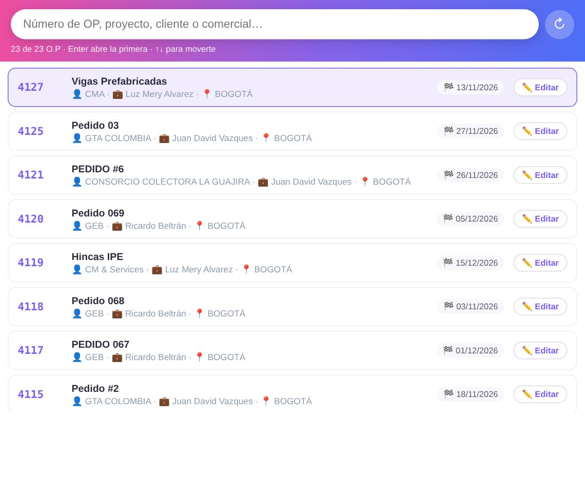

### 5.5 Reprogramar la fecha de entrega

1. Cargar la OP para editar y cambiar la fecha de entrega.
2. Al guardar, elegir el motivo: 1 Solicitud del cliente, 2 Causa interna, 3 Materiales o proveedores, 4 Cambio de alcance, 5 Otro.
3. Escribir el comentario; con "Otro" es obligatorio.

La reprogramación queda en REPROGRAMACIONES_ENTREGA y en REGISTRO_CAMBIOS. La fecha original no cambia y sigue siendo la referencia del indicador oficial. Si la OP ya tiene entrega real, no se puede reprogramar.

### 5.6 Tareas que no aplican y nombre de tarea por OP (🧩 Ajustar tareas del cronograma)

1. Abrir la hoja de la OP y usar 🧩 Ajustar tareas del cronograma (No aplica / nombre).
2. Marcar ☐ No aplica en las tareas que no se hacen en ese contrato. Su peso se reparte entre las demás tareas de la subestructura.
3. Si hace falta, escribir un "Nombre en esta OP". Solo cambia lo que ve el área; por dentro se conserva el nombre original.
4. Guardar y pulsar 📤 Enviar a las áreas.

Cada subestructura debe tener al menos una tarea que aplique. "Kg Fabricados" y "Entrega en negro" de Producción no se pueden renombrar, porque Producción V2 las usa para sincronizar los kg. No se deben borrar filas de tareas a mano.

Desde v3.2, los días planeados y reales de las tareas No aplica **no suman** en TOTAL_DIAS (en la hoja de la OP y en el cronograma del área) y esas tareas quedan con 0 % de participación. Sin tareas No aplica, todo funciona igual que antes.

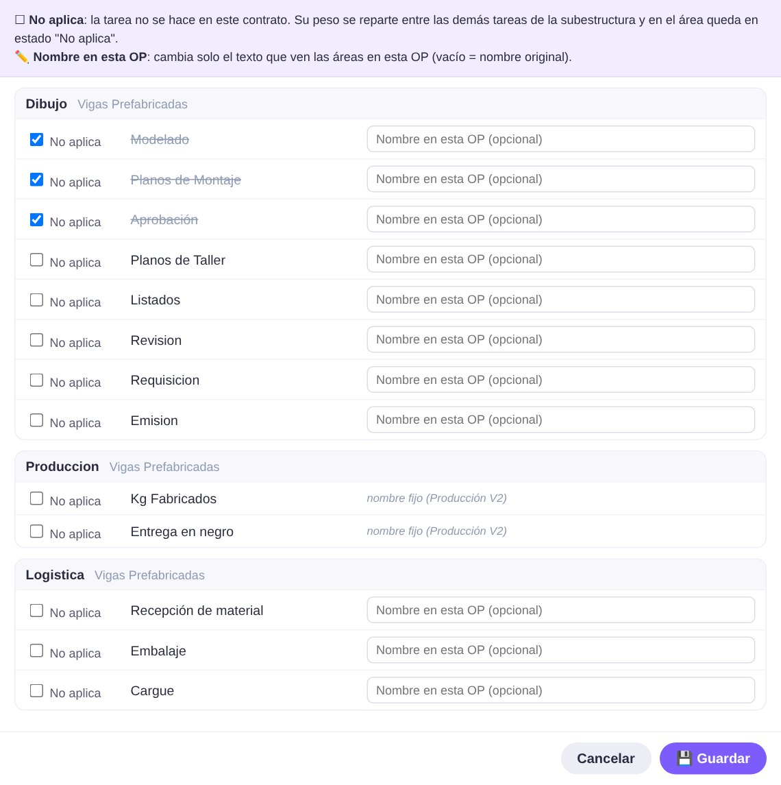

### 5.7 Registrar la entrega real

1. Usar 🚚 Registrar entrega real al cliente (desde la hoja de la OP, o escribiendo el número).
2. Escribir la fecha real (dd/mm/aaaa); no puede ser futura.
3. Escribir una observación, por ejemplo número de remisión o quién recibió.
4. La macro muestra si la entrega fue a tiempo frente a la fecha original y la vigente.

La entrega real queda fija. Solo un usuario de AUTORIZADOS_ENTREGA puede corregirla, con motivo obligatorio.

## 6. Manual de usuario — Áreas y Producción V2

Cada área registra su avance en la hoja "Cronograma" de su archivo; solo diligencia cinco columnas, y el resto lo llenan Comercial o las fórmulas.

### 6.1 Columnas que diligencia el área

| Columna | Campo | Cómo se llena |
| --- | --- | --- |
| P | ESTADO | Abierto, En pausa, Reproceso o Terminado |
| S | KG_AVANCE_ACUMULADO | Kg acumulados de la tarea (áreas que miden por kg) |
| U | FECHA_INICIO_TAREA_REAL | Fecha en que empezó la tarea. Las tareas nuevas la traen vacía; las siguientes se encadenan solas cuando la anterior tiene fin real |
| V | DURACION_DIAS_TAREAS_REAL | Días hábiles que duró o va a durar la tarea |
| AC | OBSERVACIONES | Notas de la tarea; se ven en la App con 👁 Ver observaciones |

La fecha fin real (W) se calcula sola con días hábiles y festivos de Colombia. Las columnas de plan (desde AE), la fecha de entrega (AD), los nombres de tarea y las de datos generales vienen de Comercial y no se modifican en el área.

### 6.2 Estados de una tarea

| Estado | Cuándo usarlo | Efecto |
| --- | --- | --- |
| Abierto | Estado inicial; tarea sin terminar | No suma avance por sí solo |
| En pausa | Tarea detenida | En áreas de pesos fijos suma un aporte parcial |
| Reproceso | Tarea que se está rehaciendo | Cuenta como evidencia de actividad |
| Terminado | Tarea completa | Suma su peso completo; su fecha fin real queda protegida |
| No aplica | La tarea no se hace en el contrato | Solo lo marca Comercial; no cuenta y su peso se reparte |

### 6.3 Reglas de protección en los cronogramas

- En una tarea **Terminado** con fecha real válida no se puede cambiar el inicio real, la duración real ni el fin real, ni sacarla de Terminado.
- La **fecha de entrega al cliente** no se cambia desde el área.
- **"No aplica"** no se pone ni se quita desde el área.
- Si alguien lo intenta, el cambio se deshace al instante, queda como "Intento bloqueado" en el Historial y se incluye en el siguiente correo de cambios.
- Todo cambio de estado, fechas o kg queda en el Historial con usuario, fecha y valores.

Si una fecha protegida está mal (por ejemplo, un año mal digitado), la corrige un usuario autorizado (6.5, procedimiento PR-06).

### 6.4 Producción V2 (Bogotá y Barranquilla)

Producción tiene **un archivo por planta**: PLANTILLA_LOOKER_PRODUCCION_V2 (Barranquilla) y PLANTILLA_LOOKER_PRODUCCION_V2_BOGOTA (Bogotá). Cada planta trabaja solo en el suyo, con el mismo código y los mismos menús. Una OP MIXTO aparece en los dos, pero cada archivo solo programa y sincroniza las subestructuras de su planta; las de la otra planta quedan en gris.

**Tareas de Producción en el cronograma.** Cada subestructura tiene dos tareas, cada una con 50 % del peso del área:

| Tarea | Qué mide | Se alimenta de |
| --- | --- | --- |
| Kg Fabricados | Kg fabricados de la subestructura | Fila de la OP (kg reales del día) en la hoja del mes |
| Entrega en negro | Kg entregados en negro (sin galvanizar ni pintar) | Fila ENTREGA MATERIAL EN NEGRO en la hoja del mes |

Las OP terminadas antes del cambio conservan sus 5 tareas antiguas (Corte, Armado, Soldadura, Calidad y Entrega en negro). En ellas el aporte de cada tarea depende de los kg registrados frente al peso de la subestructura: si faltan kg, Producción no llega al 100 % aunque todas las tareas digan Terminado.

**Hojas del mes.** Producción registra los kg de cada día en las hojas mensuales (por ejemplo "NOVIEMBRE 2026"). Cada subestructura es un bloque de cuatro filas:

| Fila | Qué se digita |
| --- | --- |
| OP 4127_1 · Nombre | Kg fabricados en el día |
| PLANEADO | Kg que se planeaba fabricar ese día |
| DIFERENCIA | Se calcula sola |
| ENTREGA MATERIAL EN NEGRO | Kg entregados en negro ese día. No suma en el TOTAL REAL del día; tiene su propio TOTAL ENTREGA |

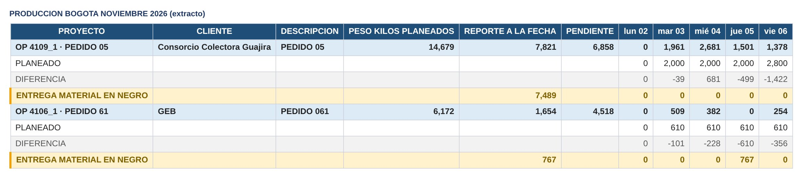

| Opción del menú 🏗️ Torre de Control | Para qué sirve |
| --- | --- |
| 📤 Enviar / Crear O.P (botón "Crear O.P - Producción") | Programa una OP o subestructura de esta planta en la hoja del mes |
| 🔄 Sincronizar diario → Cronograma | Lleva los kg fabricados y los entregados en negro al cronograma |
| ⏱ Activar sincronización automática (cada hora) | La misma sincronización cada hora; se activa una vez en cada archivo |
| 🔁 Actualizar lista de OP del formulario | Refresca la lista desplegable de OP |
| 🧹 Borrar de los meses las OP que no vienen de comercial | Limpia pruebas u OP no registradas |
| ➕ Agregar fila ENTREGA MATERIAL EN NEGRO a las OP programadas | Agrega la fila nueva a los bloques que no la tienen (una sola vez) |
| 🏭 Planta de este archivo… | Indica si el archivo es de BOGOTÁ o BARRANQUILLA (una sola vez) |
| ✂️ Separar por planta (una vez) | Deja en el archivo solo las OP de su planta y las MIXTO; guarda copia en hojas "RESPALDO_SEP · …" |

Reglas de la sincronización:

- Solo **sube** valores: nunca baja los kg, nunca saca una tarea de Terminado y no borra datos digitados.
- "Kg Fabricados" toma los kg fabricados de la subestructura y "Entrega en negro" los kg entregados en negro. Cada una pasa a Terminado cuando sus kg alcanzan el peso de la subestructura.
- Toma la fecha de inicio más temprana entre la digitada y la del primer reporte diario.
- No toca una tarea Terminado con fecha real válida ni una tarea "No aplica".
- Cada archivo sincroniza solo las subestructuras de su planta.

### 6.5 Corrección de una fecha protegida

La hace un correo incluido en AUTORIZADOS_FECHAS, editando la celda en el cronograma del área. El cambio se conserva y queda en el Historial como "Cambio autorizado".

## 7. Manual de usuario — App web Torre de Control

La App es de consulta: muestra en un solo lugar lo que registran Comercial, las áreas y Producción. Los datos no se editan aquí, salvo las Tareas de la O.P.

### 7.1 Ingreso

1. Abra la dirección de la Torre de Control en el navegador.
2. Inicie sesión con su cuenta Google @polyuprotec.com. No se aceptan cuentas de otro dominio.
3. La App carga los datos de la Maestra. Use el botón de actualizar para traer los últimos cambios.

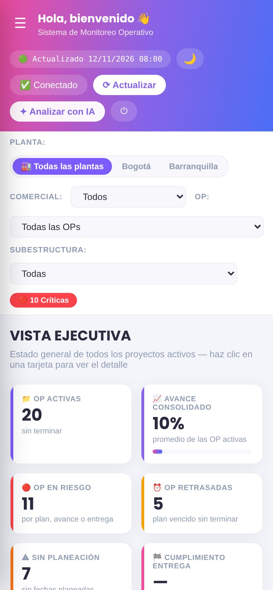

### 7.2 Banda de resumen

En la parte superior aparecen 6 indicadores generales. Al hacer clic se abre el detalle de las OP que los componen. "Cumplimiento entrega" lleva a la vista Entregas.

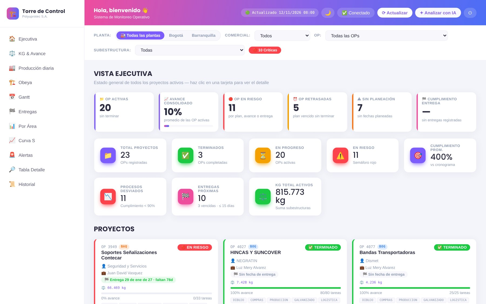

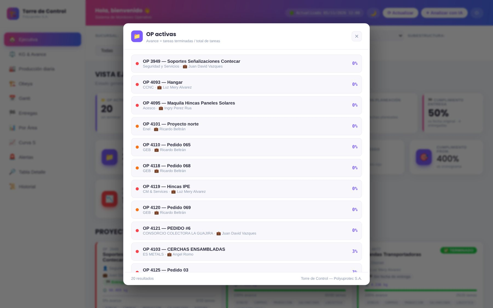

### 7.3 Vistas

Las vistas se eligen en el menú lateral. Todas respetan los filtros de la parte superior.

| Vista (menú) | Qué muestra | Uso típico |
| --- | --- | --- |
| 🏠 Ejecutiva | Banda de resumen y una tarjeta por OP con semáforo, avance, áreas en orden de proceso, insignia de planta (BOG, BAQ o MIXTO) y botón 📝 Tareas de la O.P. | Revisión diaria |
| ⚖️ KG & Avance | Kg ejecutados y avance por proceso y subestructura | Seguimiento de producción por peso |
| 🏭 Producción diaria | Kg reportados por día desde los dos archivos de Producción V2, con su planta | Producción |
| 🏗️ Obeya | Tablero por área con el avance de cada OP | Reunión de seguimiento |
| 📅 Gantt | Plan vs. real por OP con 4 fechas (dd/mm/aaaa), paginador 10/20/50/Todos y avisos ⚠ | Revisión de cronograma |
| 🏁 Entregas | Indicador de cumplimiento de entrega, gráfica y reprogramaciones | Gerencia y Comercial |
| 📊 Por Área | Avance y estados de tareas agrupados por área | Jefes de área |
| 📈 Curva S | Avance planificado vs. real acumulado por semana | Gerencia |
| 🚨 Alertas | Entregas en riesgo, OP vencidas, sin planeación, entregas inconsistentes y compromisos vencidos o bloqueos de las Tareas de la O.P. | Priorizar |
| 🔎 Tabla Detalle | Todas las tareas con columna 👁 Ver observaciones | Consultar notas de las áreas |
| 📜 Historial | Cambios y bloqueos registrados, con filtros | Auditoría |

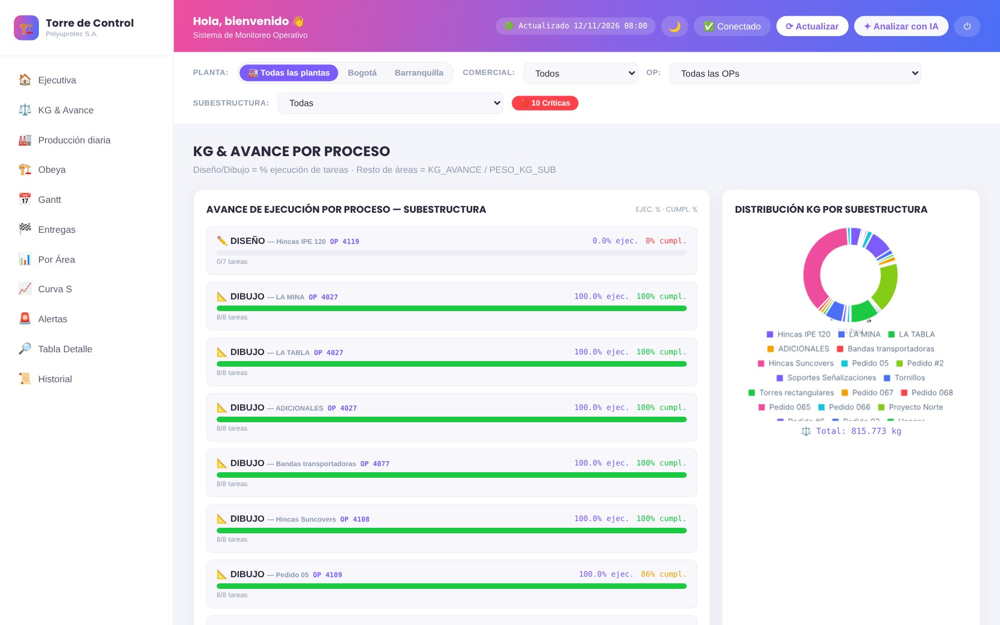

### 7.4 Semáforo y avisos

- Pase el puntero sobre el semáforo para ver **por qué** tiene ese color (regla, brecha, fechas).
- **Sin planeación** (naranja) significa que la OP no tiene fechas de plan.
- El ⚠ del Gantt indica una fecha a más de 2 años del plan o un fin real anterior al inicio; pase el puntero para ver el detalle.

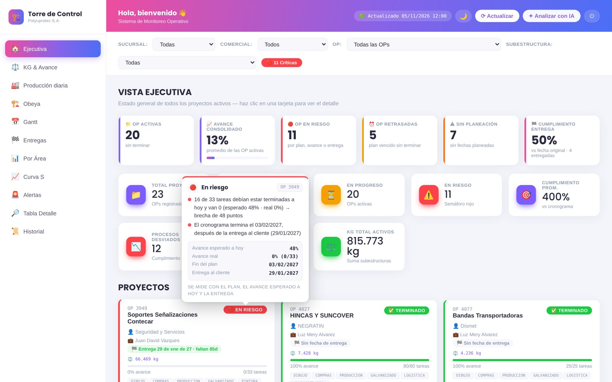

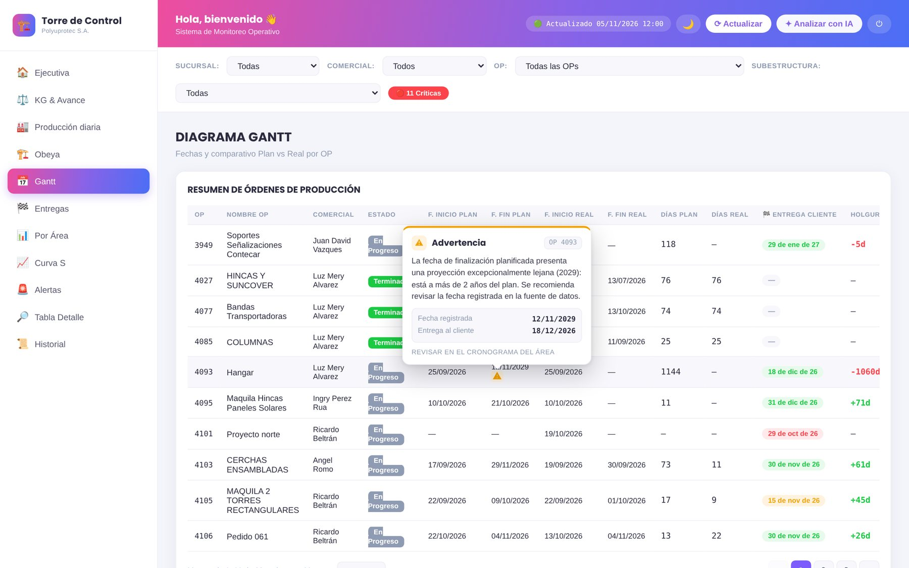

### 7.5 Filtros

Arriba de todas las vistas están los filtros **Planta**, Comercial, OP y Subestructura.

**Planta** tiene tres botones: Todas las plantas, Bogotá y Barranquilla. Al elegir una planta, todas las vistas (tarjetas, Gantt, Tabla Detalle, Producción diaria, Historial, Entregas, indicadores) muestran solo lo de esa planta:

- Las OP de esa sede y las MIXTO. En una OP MIXTO, las tareas de Producción que se ven son solo las de las subestructuras de esa planta; las demás áreas se ven completas.
- La App recuerda la planta elegida la próxima vez que se abra en ese navegador.
- Las insignias **BOG**, **BAQ** y **MIXTO** junto al número de OP indican la planta de cada OP.

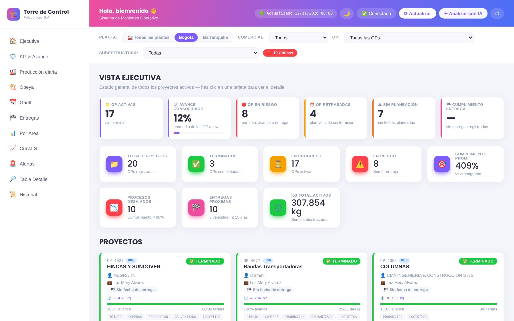

Las vistas también permiten filtrar por cliente, área y semáforo. El orden de las áreas siempre sigue el proceso: Diseño → Dibujo → Compras → Producción → Galvanizado → Pintura → Logística → Montaje → Administración → RRHH.

### 7.6 📝 Tareas de la O.P.

Aquí se suben los compromisos que se acuerdan para cada O.P. en las reuniones de seguimiento, además de notas y bloqueos. Antes se llamaba "Bitácora"; solo cambió el nombre. Cada registro lleva autor, fecha y hora.

1. En la tarjeta de la OP pulse **📝 Tareas de la O.P.**. El botón muestra cuántos registros están abiertos y cuántos vencidos.
2. Elija el tipo (nota, compromiso o bloqueo), el área y escriba la descripción.
3. Para compromisos y bloqueos indique responsable y fecha compromiso.
4. Pulse **Guardar**.
5. Para cerrar un compromiso o bloqueo, pulse **Cerrar** y escriba una nota de cierre. Los registros no se borran.

Los compromisos vencidos y los bloqueos abiertos aparecen en Alertas y en el resumen semanal que llega por correo los lunes.

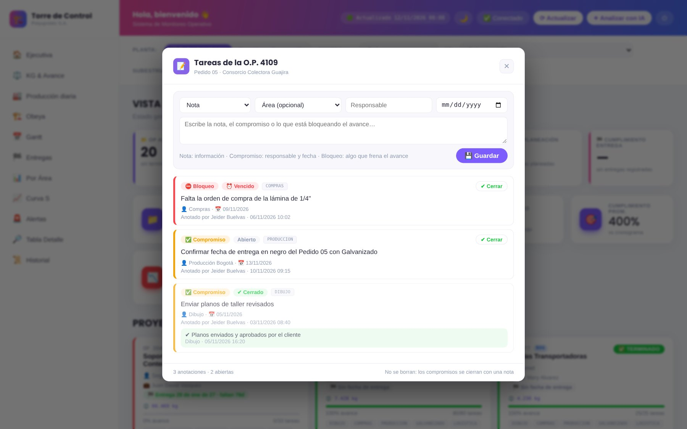

### 7.7 Entregas

Muestra por OP la fecha original, la vigente y la real, los días de diferencia y si cumplió. El indicador oficial se mide contra la fecha **original** con tolerancia de 0 días. El botón de reprogramaciones muestra cada cambio con su motivo.

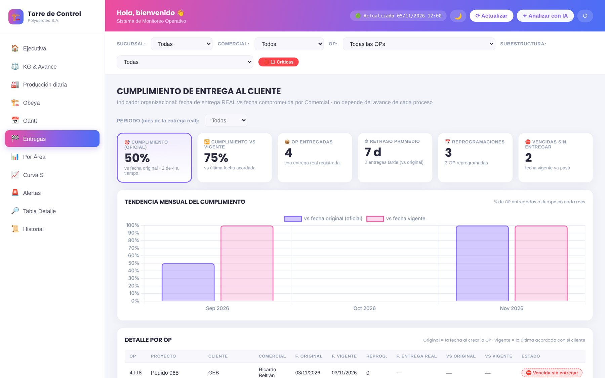

### 7.8 Historial

Lista los cambios de estado, fechas y kg, los cambios autorizados, los intentos bloqueados y lo anotado en las Tareas de la O.P. Filtre por OP, área, tipo, usuario o fecha. Los cambios hechos en un archivo de Producción llevan su planta y respetan el filtro Planta. Los registros anteriores guardados como "Bitácora" se muestran como "Tareas de la O.P.", así que en el filtro de tipo hay un solo nombre.

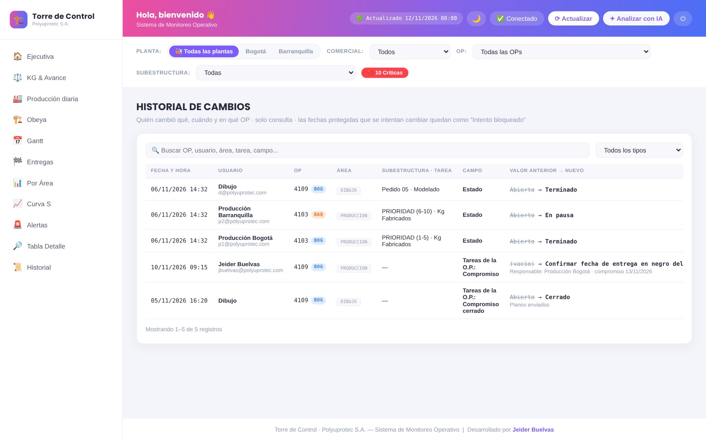

## 8. Indicadores y reglas de cálculo

Todos los indicadores se calculan en la Maestra a partir de los cronogramas. La App solo los muestra, así que la misma regla aplica en todas las vistas.

### 8.1 Avance de la OP

- Cada tarea tiene un peso (columna Q, aporte). El avance del área es la suma de los aportes de sus tareas según su estado o kg.
- Las tareas **No aplica** aportan 0 y su peso se reparte proporcionalmente entre las demás tareas del área, así que el área puede llegar al 100 %.
- En Producción, "Kg Fabricados" y "Entrega en negro" pesan 50 % cada una.
- Los días de las tareas No aplica no suman en el total de días de la subestructura (planeado ni real).
- El avance real de la OP para el semáforo es el % de tareas Terminado.

### 8.2 Semáforo (regla v4.2)

**Brecha** = avance esperado − avance real. El avance esperado es el % de tareas cuyo fin planeado ya pasó.

| Color | Se asigna cuando |
| --- | --- |
| 🔴 Rojo | La entrega está vencida y la OP no está terminada; o el cronograma termina después de la entrega; o el plan venció hace más de 7 días; o la brecha es de 25 puntos o más |
| 🟡 Amarillo | La brecha es de 10 puntos o más; o el plan venció hace 1 a 7 días; o la entrega es en 15 días o menos y el avance es menor al 80 % |
| 🟢 Al día | No se cumple ninguna de las anteriores |
| 🟠 Sin planeación | La OP no tiene fechas planeadas |

Las reglas se evalúan en ese orden; la primera que se cumple define el color y se muestra como motivo.

### 8.3 Cumplimiento y eficiencia

- **Cumplimiento %** solo se calcula si hay evidencia de avance: al menos una tarea Terminado o Reproceso, o kg mayores a 0. Sin evidencia la OP aparece como "sin avance" y no como 0 % ni 100 %.
- **Cumpl. %** por tarea solo se muestra en tareas Terminado.
- **Eficiencia** compara duración real contra planeada en tareas Terminado; sin tareas terminadas queda vacía.
- La **fecha fin real** de la OP sale solo de tareas Terminado.

### 8.4 Cumplimiento de entrega al cliente

| Fecha | Significado |
| --- | --- |
| Original | Primera fecha de entrega registrada. No se sobrescribe |
| Vigente | Fecha actual tras reprogramaciones; cada cambio exige motivo |
| Real | Fecha en que se entregó; la registra Comercial |

Una OP **cumple** si la fecha real es igual o anterior a la original (tolerancia 0 días). El indicador es el % de OP entregadas que cumplen, y se muestra también el cumplimiento contra la fecha vigente como referencia.

### 8.5 Fechas inválidas

- Una fecha anterior al año 2000 se trata como vacía.
- En el Gantt se ignora un fin real anterior al inicio real, y se marca ⚠ una fecha a más de 2 años (730 días) del plan.

## 9. Control de datos, protección, trazabilidad y notificaciones

El sistema protege las fechas que sustentan los indicadores y deja rastro de cada cambio, para que los datos de la Torre de Control sean auditables.

### 9.1 Qué se protege

| Dato | Regla | Quién puede cambiarlo |
| --- | --- | --- |
| Fecha fin real e inicio/duración real de una tarea Terminado | No se modifica ni se saca de Terminado | Usuarios en AUTORIZADOS_FECHAS |
| Fecha de entrega comercial (línea base) | Se guarda en LINEA_BASE; un cambio en el área se revierte | Solo Comercial, con motivo |
| Estado No aplica | No se pone ni se quita en el área | Solo Comercial (🧩 Ajustar tareas del cronograma) |
| Fecha original de entrega | Nunca se sobrescribe | Nadie |
| Entrega real registrada | Bloquea nuevas reprogramaciones | Usuarios en AUTORIZADOS_ENTREGA |

### 9.2 Hojas de trazabilidad

| Hoja | Archivo | Contenido |
| --- | --- | --- |
| HISTORIAL | Maestra | Cambios, cambios autorizados e intentos bloqueados: fecha, usuario, OP, área, tarea, campo, valor anterior y nuevo, y planta |
| LINEA_BASE | Maestra | Copia de las fechas protegidas para poder revertir |
| BITACORA_OP | Maestra | Tareas de la O.P.: notas, compromisos y bloqueos con su cierre |
| ENTREGAS_CLIENTE | Comercial | Una fila por OP con fecha original, vigente y real |
| REPROGRAMACIONES_ENTREGA | Comercial | Cada reprogramación con motivo, usuario y fecha |

Estas hojas pueden ocultarse sin afectar el funcionamiento, pero no deben renombrarse, borrarse ni editarse a mano.

### 9.3 Notificaciones por correo

| Correo | Cuándo | Destino |
| --- | --- | --- |
| Nueva O.P | Al registrar una OP en Comercial ("¡Se registró una nueva O.P!") | todos@polyuprotec.com |
| Resumen de cambios | Cada 15 minutos, solo si hubo cambios o bloqueos | Desarrollo y las Obeya de Bogotá y Barranquilla (lista en notificar_cambios.php) |
| 📝 Tareas de la O.P. (semanal) | Lunes a las 7:00: compromisos vencidos, los que vencen en 7 días y bloqueos abiertos | todos@polyuprotec.com |

Los correos salen de la cuenta de notificaciones del servidor de la Torre de Control. Las credenciales están solo en el servidor y no se incluyen en este documento.

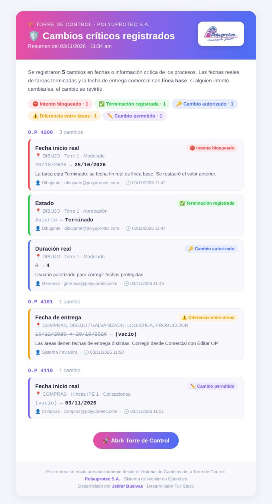

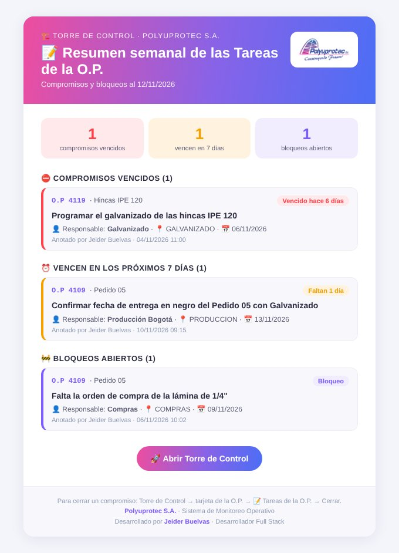

### 9.4 Seguridad de acceso

- La App y las Tareas de la O.P. exigen sesión Google del dominio polyuprotec.com.
- El autor de cada registro de las Tareas de la O.P. se toma de la sesión, no de lo que escriba el usuario.
- La comunicación entre el servidor y Apps Script usa un token privado que solo conoce el administrador.

## 10. Administración, instalación, despliegue y mantenimiento

Esta sección es para el administrador del sistema (Desarrollo Full Stack). Cubre las versiones vigentes, cómo publicar cambios y las tareas de mantenimiento.

### 10.1 Versiones vigentes (Torre de Control v3.2)

| Componente | Archivo | Versión |
| --- | --- | --- |
| Macro Comercial | MACRO_COMERCIAL | v14.10 |
| Maestra (API, semáforo, protección, historial, Tareas de la O.P.) | MAESTRA_POLYUPROTEC | v4.7 |
| Producción V2 (mismo código en Bogotá y Barranquilla) | PRODUCCION_V2 | v4.5 |
| App web | app.html + PHP (bitacora.php, notificar_cambios.php, notificar_bitacora.php, notificar_op.php) | 11/11/2026 |

### 10.2 Publicar un cambio en Apps Script

1. Haga una copia de respaldo del código actual.
2. Pegue la nueva versión en el editor de Apps Script y guarde.
3. Si el archivo es la Maestra (Web App): **Implementar → Administrar implementaciones → Editar → Versión: Nueva versión → Implementar**. No cree una implementación nueva, porque cambia la URL y la App deja de recibir datos.
4. Recargue la hoja para que aparezca el menú actualizado.
5. Verifique en la App que los datos y el semáforo cargan.

### 10.3 Activadores

| Activador | Archivo | Cómo se instala |
| --- | --- | --- |
| Protección de cronogramas (onEdit en cada área) | Maestra | Menú → Instalar protección |
| Resumen de cambios (cada 15 min) | Maestra | Se instala con la protección |
| Correo semanal de Tareas de la O.P. (lunes 7:00) | Maestra | Menú → 📅 Activar correo semanal de Tareas de la O.P. |
| Sincronización diaria (cada hora) | Producción V2, en cada archivo (Bogotá y Barranquilla) | Menú → ⏱ Activar sincronización automática |

Para revisar o eliminar activadores use el panel "Activadores" del proyecto de Apps Script. Instale cada activador una sola vez para evitar correos duplicados.

### 10.4 Servidor web

- Suba app.html y los archivos PHP a la carpeta de la Torre de Control en el hosting.
- Configure en cada PHP la URL de la Web App, el token y los datos SMTP. Estos valores no se documentan aquí; los custodia el administrador.
- Pruebe con las opciones del menú "✉️ Probar correo de cambios" y "✉️ Probar correo de Tareas de la O.P.".

### 10.5 Parámetros configurables

| Parámetro | Dónde | Valor actual |
| --- | --- | --- |
| AUTORIZADOS_FECHAS | Maestra | Vacío (debe diligenciarse) |
| AUTORIZADOS_ENTREGA | Comercial | Vacío (debe diligenciarse) |
| ORDEN_AREAS | Comercial y App | Diseño → … → RRHH |
| MOTIVOS_REPROG | Comercial | Lista de motivos de reprogramación |
| TOLERANCIA_ENTREGA_DIAS | App | 0 |
| GANTT_DIAS_AVISO | App | 730 |
| ID_COMERCIAL / ID_MAESTRA | Maestra | IDs de los archivos de Google Sheets |
| IDS_PRODUCCION_PLANTA | Comercial | ID del archivo de Producción de cada planta (Bogotá y Barranquilla) |

### 10.6 Mantenimiento periódico

- **Semanal:** revisar en Historial los intentos bloqueados y en Alertas las OP sin planeación o con entregas inconsistentes.
- **Mensual:** crear la hoja del nuevo mes en los dos archivos de Producción V2 y revisar que la sincronización corre en ambos.
- **Trimestral:** revisar el tamaño de HISTORIAL y BITACORA_OP (Tareas de la O.P.) y archivar si pasa de varios miles de filas; revisar la lista de autorizados.
- **Ante cada cambio:** aplicar la regla "original funcional + solo modificaciones = final" y comparar original vs. final antes de publicar.

## 11. Solución de problemas frecuentes

La mayoría de las fallas vistas en la operación vienen de datos digitados o de no publicar la nueva versión de la Web App, no del código.

| Síntoma | Causa probable | Solución |
| --- | --- | --- |
| Un cambio en el código no se ve en la App (p. ej. no sale el motivo del semáforo) | No se publicó una nueva versión de la Web App | Implementar → Administrar implementaciones → Editar → Nueva versión (10.2) |
| Error "ID ilegal" o la vista Entregas sale vacía | ID_COMERCIAL mal escrito (por ejemplo l minúscula en vez de I mayúscula) | Copiar el ID desde la URL del archivo, sin digitarlo |
| Una OP no muestra fecha de entrega | La OP no tiene fecha en Comercial ni en las áreas | Registrar la fecha en Comercial |
| Alerta "entregas distintas" | Las áreas tienen fechas de entrega diferentes para la misma OP | Comercial corrige y envía la OP a las áreas |
| ⚠ en el Gantt con año lejano (p. ej. 2029) | Año mal digitado en una fecha | Corregir la fecha (si está protegida, por un autorizado) |
| Duración de miles de días | Fecha de inicio con año 1900 | Ya se trata como vacía (V2 v4.1); digitar la fecha correcta |
| El semáforo está en "Al día" sin avance | Versión antigua de la Maestra | Verificar que está en v4.2 o superior |
| "Sin planeación" | La OP no tiene fechas de plan | Comercial programa el cronograma |
| Filas duplicadas en ENTREGAS_CLIENTE | Ejecución simultánea en versiones anteriores a v14.1 | Usar v14.1 o superior; la Maestra ya ignora duplicados |
| Mi cambio se deshizo solo | Se intentó modificar un dato protegido | Ver el registro en Historial y pedir la corrección a un autorizado |
| Buscar O.P tarda al abrir una OP | Primera carga de la lista | Esperar la barra "Abriendo O.P…"; no cerrar el cuadro antes de que termine |
| No llegan correos | Activador no instalado o datos SMTP del servidor | Revisar activadores y probar con "Probar correo" |
| Las Tareas de la O.P. no guardan | Sesión vencida o cuenta fuera del dominio | Volver a iniciar sesión con la cuenta @polyuprotec.com |
| Un área no llega al 100 % | Tareas que no se hacen siguen activas | Comercial las marca No aplica en 🧩 Ajustar tareas del cronograma |
| Una OP antigua de Producción (5 tareas) no cierra aunque todo esté Terminado | Faltan kg registrados: el aporte depende de los kg frente al peso de la subestructura | Registrar los kg que faltan; si se fabricaron todos, KG_AVANCE_ACUMULADO debe igualar el peso de la subestructura |
| Al enviar una OP sale "No se pueden combinar celdas en una fila filtrada" | El área dejó un filtro activo en su Cronograma (versiones anteriores a v14.10) | Desde Comercial v14.10 el filtro se suelta y se restaura solo; con una versión anterior, quitar el filtro y volver a enviar |
| #DIV/0! o 01/01/1900 en el cronograma de un área | Fórmulas anteriores a v14.9 sin datos reales todavía | Comercial: menú 🩹 Corregir fórmulas |
| Editar OP corta la carga o sale un aviso de validación en C6 | El comercial guardado ya no está en la lista desplegable | Desde v14.9 la OP se carga igual y se escoge el comercial en C6 |
| Una OP no aparece al filtrar por planta | La sede de la OP no corresponde a esa planta | Revisar la sede en Comercial; las OP MIXTO aparecen en las dos plantas |

### 11.1 Casos de datos pendientes a la fecha

- OP 4093: fecha de Montaje con año 2029.
- OP 4101: fechas de entrega inconsistentes entre áreas.
- OP 4027, 4077 y 4085: sin fecha de entrega. La 4085 ya quedó con Producción al 100 % (12/11/2026).
- OP 4127: Armado y Soldadura deben marcarse No aplica.
- Listas AUTORIZADOS_FECHAS y AUTORIZADOS_ENTREGA vacías.

## 12. Insumos para procedimientos internos

Estos son los procedimientos que propone el sistema tal como funciona hoy. Cada uno puede pasarse al formato oficial de calidad de la empresa.

### PR-01 Registro de una nueva OP

- **Responsable:** Comercial. **Frecuencia:** cada contrato nuevo.
- **Pasos:** 1) Crear la OP en la base del creador con datos generales y subestructuras. 2) Registrar la fecha de entrega comprometida (queda como fecha original). 3) Ajustar tareas con 🧩 Ajustar tareas del cronograma (No aplica, nombres). 4) Enviar la OP a las áreas. 5) Programar en Producción V2, en el archivo de la planta que corresponda.
- **Registros:** hoja de la OP, ENTREGAS_CLIENTE, correo "Se registró una nueva O.P".

### PR-02 Actualización de avance por área

- **Responsable:** jefe o encargado de cada área. **Frecuencia:** diaria o cada vez que cambie una tarea.
- **Pasos:** 1) Abrir el cronograma del área. 2) Actualizar estado, inicio real, duración y kg. 3) Marcar Terminado solo cuando la tarea esté completa. 4) Escribir observaciones si hay novedades.
- **Registros:** cronograma del área, HISTORIAL.

### PR-03 Reporte diario de producción

- **Responsable:** Producción de cada planta (Bogotá y Barranquilla). **Frecuencia:** diaria.
- **Pasos:** 1) En el archivo de su planta, digitar en la hoja del mes los kg fabricados del día (fila de la OP) y los kg entregados en negro (fila ENTREGA MATERIAL EN NEGRO). 2) Verificar que la sincronización automática corrió o ejecutarla manualmente.
- **Registros:** PRODUCCION_V2 de cada planta, cronograma de Producción.

### PR-04 Reprogramación de la fecha de entrega

- **Responsable:** Comercial, con visto bueno de la Gerencia. **Frecuencia:** cuando se requiera.
- **Pasos:** 1) Editar la OP y cambiar la fecha de entrega. 2) Elegir el motivo (obligatorio). 3) Guardar y enviar a las áreas. 4) Informar al cliente.
- **Registros:** REPROGRAMACIONES_ENTREGA. La fecha original no cambia y el indicador oficial sigue midiendo contra ella.

### PR-05 Registro de la entrega real

- **Responsable:** Comercial. **Frecuencia:** cada entrega al cliente.
- **Pasos:** 1) Usar "Registrar entrega". 2) Digitar la fecha real con soporte (remisión o acta). 3) Verificar en la vista Entregas.
- **Registros:** ENTREGAS_CLIENTE.

### PR-06 Corrección de fechas protegidas

- **Responsable:** usuario autorizado (AUTORIZADOS_FECHAS). **Frecuencia:** excepcional.
- **Pasos:** 1) Recibir la solicitud con justificación. 2) Corregir la celda en el cronograma. 3) Verificar en Historial que quedó como "Cambio autorizado".
- **Registros:** HISTORIAL, solicitud escrita.

### PR-07 Gestión de las Tareas de la O.P.

- **Responsable:** cualquier usuario; cierra el responsable del compromiso o bloqueo. **Frecuencia:** continua.
- **Pasos:** 1) Registrar desde la App, en 📝 Tareas de la O.P., los compromisos acordados en cada reunión, las notas y los bloqueos. 2) Revisar el correo de los lunes. 3) Cerrar con nota cuando se cumpla.
- **Registros:** BITACORA_OP.

### PR-08 Seguimiento semanal de la Torre de Control

- **Responsable:** Gerencia de proyectos y jefes de área. **Frecuencia:** semanal.
- **Pasos:** 1) Revisar banda de resumen y OP en rojo o amarillo con su motivo. 2) Revisar Alertas, Tareas de la O.P. y cumplimiento de entregas. 3) Definir compromisos y registrarlos en 📝 Tareas de la O.P.
- **Registros:** BITACORA_OP, acta de reunión.

### PR-09 Control de cambios del sistema

- **Responsable:** Desarrollo Full Stack. **Frecuencia:** cada cambio.
- **Pasos:** 1) Recibir la solicitud. 2) Explicar el cambio antes de programarlo. 3) Partir del original funcional y aplicar solo las modificaciones. 4) Probar comparando original vs. final. 5) Publicar (10.2) y actualizar la tabla de versiones.
- **Registros:** archivos de versión, este documento.

## 13. Glosario y anexos

### 13.1 Glosario

| Término | Definición |
| --- | --- |
| OP | Orden de producción; corresponde a un contrato o pedido |
| Subestructura | Parte de una OP con su propio peso en kg (p. ej. OP 4127_1) |
| Maestra | Archivo que reúne los cronogramas de todas las áreas y sirve los datos a la App |
| Cronograma | Hoja de cada área con las tareas, el plan y el avance real de cada OP |
| Línea base | Fechas comprometidas que se guardan para compararlas y protegerlas |
| Fecha original | Primera fecha de entrega registrada; base del indicador oficial |
| Fecha vigente | Fecha de entrega actual tras reprogramaciones |
| Brecha | Avance esperado menos avance real, en puntos porcentuales |
| Evidencia | Tarea Terminado o Reproceso, o kg mayores a 0 |
| No aplica | Tarea que no se ejecuta en esa OP; su peso se reparte |
| Obeya | Tablero visual de seguimiento por área |
| Tareas de la O.P. | Registro de compromisos de reunión, notas y bloqueos por OP (antes "Bitácora") |
| Planta | Sede de Producción: Bogotá o Barranquilla. Cada una tiene su archivo de Producción V2 |
| MIXTO | OP con subestructuras en las dos plantas |
| Kg Fabricados | Tarea de Producción que mide los kg fabricados (50 %) |
| Entrega en negro | Tarea de Producción que mide los kg entregados sin galvanizar ni pintar (50 %) |
| Web App | Servicio de Apps Script que entrega los datos de la Maestra a la App |
| Activador | Tarea automática de Apps Script (por edición o por tiempo) |

### 13.2 Anexos que acompañan este documento

| Anexo | Contenido |
| --- | --- |
| A | Código fuente: MACRO_COMERCIAL v14.10, MAESTRA_POLYUPROTEC v4.7, PRODUCCION_V2 v4.5 |
| B | Paquete de la App web (app.html y archivos PHP) |
| C | Botones PNG de las macros |
| D | Acta de acuerdos de la reunión del 03/11 |
| E | Lista de usuarios autorizados (a diligenciar) |

El código y los paquetes se entregan aparte. No contienen ni deben contener contraseñas en documentos compartidos.

### 13.3 Control del documento

| Versión | Fecha | Descripción | Elaboró |
| --- | --- | --- | --- |
| 1.0 | 05/11/2026 | Versión inicial para procedimientos y manual | Jeider Buelvas — Desarrollo Full Stack |
| 1.1 | 12/11/2026 | Torre de Control v3.2: Producción con Kg Fabricados y Entrega en negro, dos plantas, 📝 Tareas de la O.P., correcciones de Comercial v14.9 y v14.10 | Jeider Buelvas — Desarrollo Full Stack |
|  |  |  |  |
